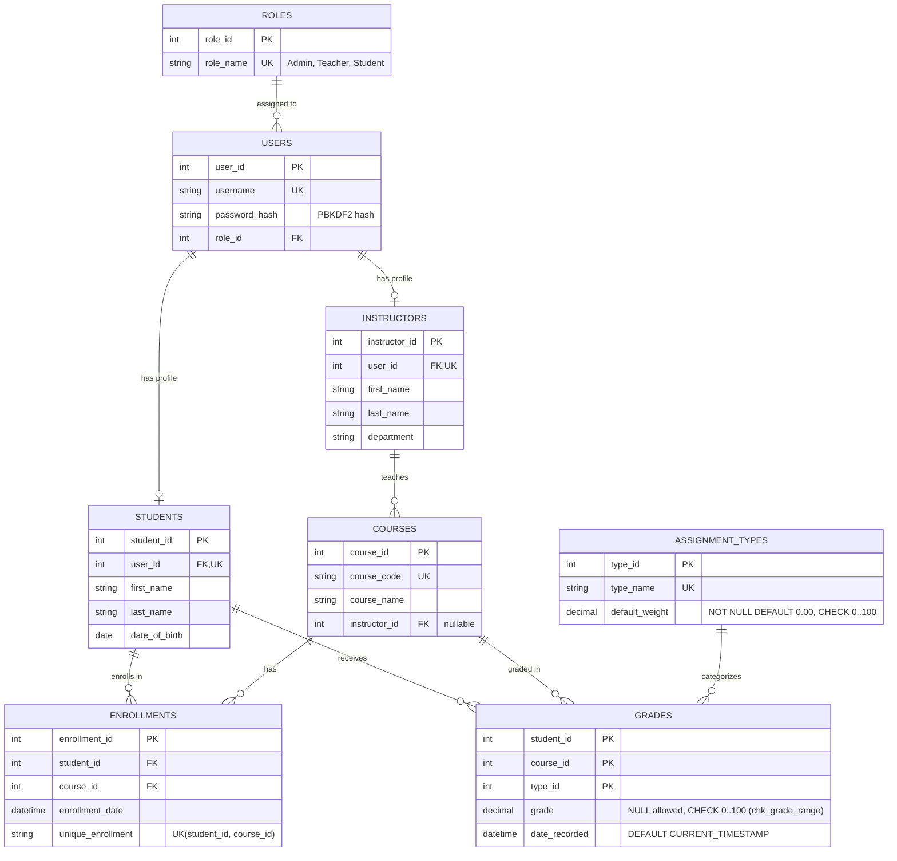

# ER Diagram — DB_Timon (Final Lab 5 Schema)

`GRADES` is a ternary relationship: its **composite primary key is
(student_id, course_id, type_id)**, so one student can have only one grade per
assignment type per course. It has three foreign keys — to `students`,
`courses` and `assignment_types` — each with the default restrictive delete
behaviour. `assignment_types.default_weight` is constrained to 0–100 and is
used by `sp_CalculateCourseGrade` for the weighted average.

Views built on these tables:

- `student_grade_summary` — student/course/type/grade rows for the Student dashboard.
- `teacher_course_overview` — per-course, per-type submission counts and average grades, including `instructor_id`/`user_id` for teacher filtering.
- `student_transcript` — enrollment-based transcript with grade, weight and instructor.
- `course_performance_analytics` — per-course enrolled students, grades submitted, average/min/max grade.

Lab 5 performance indexes (all created only when missing):

| Index | Table | Columns | Purpose |
|---|---|---|---|
| `idx_grades_student_course` | grades | (student_id, course_id) | Fast grade lookups per student/course, student dashboard, weighted-grade calculation |
| `idx_enrollments_date` | enrollments | (enrollment_date) | Date-range enrollment searches and reporting |
| `idx_courses_code_name` | courses | (course_code, course_name) | Course-code search and auto-complete |

Note: `grades` already has a composite PK beginning with (student_id, course_id),
so `idx_grades_student_course` duplicates that leftmost prefix; it is kept as an
explicitly named access path for the dashboard queries.

Relationships to show in dbGate's ER diagram:

1. `roles.role_id` → `users.role_id` (many users to one role)
2. `users.user_id` → `instructors.user_id` (one-to-one; UNIQUE FK)
3. `users.user_id` → `students.user_id` (one-to-one; UNIQUE FK)
4. `instructors.instructor_id` → `courses.instructor_id` (one instructor teaches many courses)
5. `students.student_id` → `enrollments.student_id` (one student has many enrollments)
6. `courses.course_id` → `enrollments.course_id` (one course has many enrollments)
7. `students.student_id` → `grades.student_id` (one student has many grades)
8. `courses.course_id` → `grades.course_id` (one course has many grades)
9. `assignment_types.type_id` → `grades.type_id` (one type categorizes many grades)
